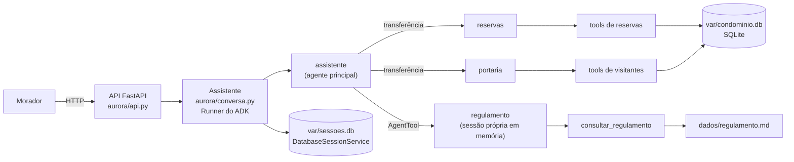

# Residencial Aurora: assistente virtual

Assistente do aplicativo dos moradores do Residencial Aurora, construído com **Google ADK 2.9.1** e exposto por uma API **FastAPI** em `http://localhost:8000`. Pelo chat, o morador reserva o salão de festas, a churrasqueira e a quadra, cancela as próprias reservas, autoriza visitantes e tira dúvidas sobre o regulamento.

A ideia que guia o projeto: **o modelo decide o caminho, o código decide o que é permitido.** As cinco garantias do desafio estão no código (tools, banco e API), não no prompt. O prompt só reforça.

- [Arquitetura](#arquitetura)
- [Garantias](#garantias)
- [Como rodar](#como-rodar)

---

## Arquitetura



### Agentes

Os agentes são montados em [`aurora/agentes.py`](aurora/agentes.py).

| Agente | Responsabilidade | Como é acionado | Por quê |
|---|---|---|---|
| `assistente` (principal) | Entende o pedido e encaminha. Responde cumprimentos e conversa geral. Não tem tools de dados nem o regulamento nas instruções. | Raiz do `App` `residencial_aurora`. Todo turno novo começa nele ou no último especialista. | Um ponto único de entrada mantém os especialistas focados e o prompt do principal pequeno. |
| `reservas` | Consulta disponibilidade, lista, reserva e cancela reservas do apartamento da sessão. | **Transferência** (`sub_agents` do principal). | Reservar área com taxa pede confirmação. O pedido de confirmação precisa ficar gravado **na sessão principal** e a aprovação precisa voltar para **este** agente (ver abaixo). |
| `portaria` | Autoriza visitantes e lista as visitas autorizadas do apartamento da sessão. | **Transferência** (`sub_agents` do principal). | Mesmo motivo: autorizar visitante sempre pede confirmação. |
| `regulamento` | Responde dúvidas lendo **um capítulo por vez** de `dados/regulamento.md`. | **`AgentTool`** do principal. | O `AgentTool` roda o especialista numa sessão própria, em memória. Só a resposta final volta para a sessão principal, então os capítulos lidos nunca entram nos eventos (Garantia 4). Ele não precisa de confirmação, então rodar fora da sessão não atrapalha. |

**Por que `reservas` e `portaria` podem transferir** (sem `disallow_transfer_to_parent/peers`): no ADK 2.9.1, a aprovação de uma confirmação só é processada pelo agente que fez o pedido. O agente principal ignora confirmações pedidas por outro agente (`flows/llm_flows/request_confirmation.py`). E o Runner só entrega a aprovação ao especialista se ele for "transferível" na árvore (`agents/_agent_router.find_agent_to_run`).

Testamos as quatro combinações, com sessão em SQLite e o Runner recriado entre o pedido e a aprovação:

| App retomável | Especialistas podem transferir | Aprovação |
|---|---|---|
| sim | não | perdida, sem erro: nada executa |
| sim | sim | **chega ao especialista e executa uma vez** |
| não | não | perdida, sem erro: nada executa |
| não | sim | **chega ao especialista e executa uma vez** |

Por isso os especialistas podem transferir, de volta ao principal e entre si. O efeito colateral é que o turno seguinte do morador começa no último especialista, e as instruções mandam ele transferir quando o assunto muda. O `App` usa `ResumabilityConfig(is_resumable=True)`, o caminho do ADK 2 para pausar em chamadas longas.

### Modelos

Os agentes usam a [`CadeiaDeModelos`](aurora/modelos.py): uma lista de modelos Gemini tentada em ordem. Quando um modelo responde 429 (cota), 503 (sobrecarga) ou 404 (modelo indisponível para a chave), a mesma requisição vai para o próximo.

No plano gratuito do AI Studio, vários modelos têm limite de **20 requisições por dia por projeto**, e o fluxo completo do avaliador faz algumas dezenas de chamadas. Com a cadeia, as cotas se somam.

A ordem padrão é `gemini-3.6-flash → gemini-3.5-flash → gemini-2.5-flash → gemini-3.5-flash-lite → gemini-3.1-flash-lite`, e pode ser trocada em `AURORA_MODELOS`. Se todos falharem, a API responde `503` com uma mensagem.

### Código

| Arquivo | Conteúdo |
|---|---|
| [`aurora/api.py`](aurora/api.py) | Rotas do contrato e tratamento de `404`, `409` e `503` |
| [`aurora/conversa.py`](aurora/conversa.py) | Runner, sessões persistidas, confirmações pendentes e resposta às confirmações |
| [`aurora/agentes.py`](aurora/agentes.py) | Agentes, instruções e `App` |
| [`aurora/tools.py`](aurora/tools.py) | Tools chamadas pelo modelo |
| [`aurora/condominio.py`](aurora/condominio.py) | Operações sobre reservas e visitantes, sempre filtradas pelo apartamento |
| [`aurora/banco.py`](aurora/banco.py) | Esquema SQLite, transações, carga e restauração do estado inicial |
| [`aurora/regulamento.py`](aurora/regulamento.py) | Regulamento separado em 14 capítulos |
| [`aurora/modelos.py`](aurora/modelos.py) | Cadeia de modelos Gemini |
| [`aurora/restaurar.py`](aurora/restaurar.py) | Comando de restauração |
| [`aurora/__main__.py`](aurora/__main__.py) | Comando de subida (`python -m aurora`) |
| [`scripts/fluxo_avaliador.py`](scripts/fluxo_avaliador.py) | Roda o fluxo do avaliador (passos 1 a 14) contra a API |

Os arquivos de `dados/` são só o estado inicial e não são alterados. O que o assistente grava vai para `var/` (fora do Git):

- `var/condominio.db`: reservas, visitantes, códigos emitidos e o vínculo entre sessão e apartamento.
- `var/sessoes.db`: sessões e eventos do ADK.

---

## Garantias

### Garantia 1: cobrança ou acesso só com confirmação

**Onde:** [`aurora/tools.py`](aurora/tools.py) (`reservar_area`, `autorizar_visitante`, `_pedir_confirmacao`), [`aurora/conversa.py`](aurora/conversa.py) (`responder_confirmacao`, `confirmacoes_pendentes`) e [`aurora/api.py`](aurora/api.py) (`409`).

A tool decide em código, pela taxa de `dados/areas.json`, se a ação pede confirmação. Ela só grava quando `tool_context.tool_confirmation` chega aprovado:

[`aurora/tools.py`](aurora/tools.py#L68-L81)
```python
    if a.gera_cobranca:
        confirmacao = tool_context.tool_confirmation
        if confirmacao is None:
            if not condominio.data_livre(a.id, data):
                return _indisponivel(a, data)
            return _pedir_confirmacao(
                tool_context,
                hint=f"Confirmar a reserva de {a.nome} em {data}, com taxa de R$ {a.taxa:.2f}.",
                detalhes={"area": a.id, "data": data, "taxa": a.taxa},
            )
        if not confirmacao.confirmed:
            return _recusada("A reserva não foi feita: o morador não aprovou a cobrança.")

    reserva = condominio.criar_reserva(apartamento_da_sessao(tool_context), a.id, data)
```

`autorizar_visitante` faz o mesmo, mas **sempre**, sem condição de taxa:

[`aurora/tools.py`](aurora/tools.py#L149-L159)
```python
    confirmacao = tool_context.tool_confirmation
    if confirmacao is None:
        return _pedir_confirmacao(
            tool_context,
            hint=f"Autorizar a entrada de {nome} no prédio em {data}.",
            detalhes={"nome": nome, "data": data},
        )
    if not confirmacao.confirmed:
        return _recusada("A entrada não foi liberada: o morador não aprovou.")

    nova = condominio.autorizar_visitante(apartamento_da_sessao(tool_context), nome, data)
```

O ADK só preenche `tool_confirmation` quando o cliente responde ao pedido `adk_request_confirmation` com um `FunctionResponse`. A API só monta esse `FunctionResponse` na rota de confirmações, e só para um `id` **pendente na própria sessão**:

[`aurora/conversa.py`](aurora/conversa.py#L79-L90)
```python
    async def responder_confirmacao(self, session_id: str, confirmacao_id: str, confirmado: bool) -> Resultado:
        async with self._travas[session_id]:
            sessao = await self._sessao(session_id)
            if confirmacao_id not in {p.id for p in confirmacoes_pendentes(sessao.events)}:
                raise ConfirmacaoInexistente(confirmacao_id)
            resposta = types.FunctionResponse(
                name=REQUEST_CONFIRMATION_FUNCTION_CALL_NAME,
                id=confirmacao_id,
                response={"confirmed": confirmado},
            )
            conteudo = types.Content(role="user", parts=[types.Part(function_response=resposta)])
            return await self._rodar(sessao, conteudo)
```

As pendências saem dos eventos gravados. Um pedido deixa de estar pendente assim que a resposta do morador é gravada, então reenviar o mesmo `id` recebe `409`:

[`aurora/conversa.py`](aurora/conversa.py#L120-L137)
```python
    respondidas = {
        resposta.id
        for evento in eventos
        if evento.author == "user"
        for resposta in evento.get_function_responses()
        if resposta.name == REQUEST_CONFIRMATION_FUNCTION_CALL_NAME
    }
    pendentes = []
    for evento in eventos:
        for chamada in evento.get_function_calls():
            # Pedidos gerados pelo ADK são marcados como long-running; uma chamada
            # com esse nome inventada pelo modelo não seria.
            if (
                chamada.name != REQUEST_CONFIRMATION_FUNCTION_CALL_NAME
                or chamada.id in respondidas
                or chamada.id not in (evento.long_running_tool_ids or set())
            ):
                continue
```

[`aurora/api.py`](aurora/api.py#L145-L149)
```python
    @api.exception_handler(ConfirmacaoInexistente)
    async def confirmacao_inexistente(request: Request, e: ConfirmacaoInexistente) -> JSONResponse:
        return JSONResponse(
            {"detail": "Não existe confirmação pendente com esse id nesta sessão."}, status_code=409
        )
```

**Por que não depende do modelo:**
- O texto do morador sempre entra como texto (`enviar_mensagem`). "Já estou confirmando aqui" nunca vira `FunctionResponse` e não preenche `tool_confirmation`.
- Quem decide se há cobrança é a taxa de `areas.json`, não o modelo.
- O `409` também é necessário: sozinho, o ADK só descarta uma resposta repetida dentro do mesmo turno. Num turno novo, ele executaria a tool de novo.
- Ação sem taxa (quadra) ou sem acesso (cancelamento) não pede confirmação.

### Garantia 2: cada sessão pertence a um apartamento

**Onde:** [`aurora/conversa.py`](aurora/conversa.py) (`criar_sessao`), [`aurora/tools.py`](aurora/tools.py) (`apartamento_da_sessao`) e [`aurora/condominio.py`](aurora/condominio.py) (filtro `WHERE apartamento = ?`).

O apartamento é definido uma única vez, como o `user_id` da sessão do ADK:

[`aurora/conversa.py`](aurora/conversa.py#L64-L68)
```python
    async def criar_sessao(self, apartamento: str) -> str:
        # O apartamento vira o user_id da sessão: é dele que as tools leem (Garantia 2).
        sessao = await self.sessoes.create_session(app_name=NOME_APP, user_id=apartamento)
        banco.registrar_sessao(sessao.id, apartamento)
        return sessao.id
```

As tools leem o apartamento só dali. **Nenhuma tool tem parâmetro de apartamento**, então o modelo não tem como escolher outro:

[`aurora/tools.py`](aurora/tools.py#L23-L25)
```python
def apartamento_da_sessao(tool_context: ToolContext) -> str:
    """Apartamento dono da sessão. O modelo não tem como escolher outro."""
    return tool_context.user_id
```

A consulta à agenda diz só se a data está livre:

[`aurora/condominio.py`](aurora/condominio.py#L103-L112)
```python
def data_livre(area_id: str, data: str) -> bool:
    """Diz só se a área está livre na data, sem revelar de quem é a reserva."""
    _area(area_id)
    data = validar_data(data)
    with banco.leitura() as con:
        ocupada = con.execute(
            "SELECT 1 FROM reservas WHERE area = ? AND data = ? AND status = 'ativa'",
            (area_id, data),
        ).fetchone()
    return ocupada is None
```

Cancelar a reserva de outro apartamento responde exatamente como uma reserva inexistente:

[`aurora/tools.py`](aurora/tools.py#L111-L117)
```python
    reserva = condominio.cancelar_reserva(apartamento_da_sessao(tool_context), area_id=a.id, data=data)
    if reserva is None:
        # Mesma resposta exista ou não reserva de outro apartamento nessa data.
        return {
            "status": "nao_encontrada",
            "mensagem": f"O apartamento do morador não tem reserva de {a.nome} em {data}.",
        }
```

**Por que não depende do modelo:**
- O `user_id` da sessão é somente leitura no `ToolContext` e é fixado pela API na criação da sessão.
- Todas as consultas e gravações de reservas e visitantes filtram por esse apartamento no SQL.
- Como os retornos das tools nunca trazem dados de outro apartamento, esses dados também não entram nos eventos nem na resposta, mesmo que o morador diga "sou do 302".

### Garantia 3: nada se perde no reinício

**Onde:** [`aurora/conversa.py`](aurora/conversa.py) (`DatabaseSessionService`) e [`aurora/banco.py`](aurora/banco.py) (SQLite e `inicializar`).

[`aurora/conversa.py`](aurora/conversa.py#L54-L57)
```python
    def __init__(self, modelos: Mapping[str, BaseLlm] | None = None):
        url = f"sqlite+aiosqlite:///{config.BANCO_SESSOES.as_posix()}"
        self.sessoes = DatabaseSessionService(db_url=url)
        self.runner = Runner(app=construir_app(modelos), session_service=self.sessoes)
```

[`aurora/banco.py`](aurora/banco.py#L93-L98)
```python
def inicializar() -> None:
    """Cria o esquema e, se o banco é novo, carrega o estado inicial de dados/."""
    _criar_esquema()
    with transacao() as con:
        if con.execute("SELECT 1 FROM meta WHERE chave = 'carga_inicial'").fetchone() is None:
            _carregar_estado_inicial(con)
```

**Por que não depende do modelo:**
- Sessões e eventos ficam em `var/sessoes.db`, gravados pelo ADK a cada evento. Reservas e visitantes ficam em `var/condominio.db`. Nada fica só em memória.
- Subir a API de novo não recarrega `dados/`: só a restauração faz isso.
- As confirmações pendentes são calculadas a partir dos eventos gravados, então uma pendência criada antes do reinício pode ser aprovada depois dele.
- Testado derrubando o processo da API à força entre os passos 12 e 13.

### Garantia 4: o regulamento é consultado, não carregado

**Onde:** [`aurora/agentes.py`](aurora/agentes.py) (`AgentTool` e instruções), [`aurora/regulamento.py`](aurora/regulamento.py) e [`aurora/tools.py`](aurora/tools.py) (`consultar_regulamento`).

O especialista do regulamento é um `AgentTool` do principal:

[`aurora/agentes.py`](aurora/agentes.py#L68-L75)
```python
    assistente = LlmAgent(
        name="assistente",
        model=modelo("assistente"),
        description="Assistente virtual do Residencial Aurora.",
        instruction=_instrucao_assistente,
        sub_agents=[reservas, portaria],
        tools=[AgentTool(agent=especialista_regulamento)],
    )
```

A tool devolve um único capítulo:

[`aurora/tools.py`](aurora/tools.py#L177-L181)
```python
    encontrado = regulamento.capitulo(capitulo)
    if encontrado is None:
        numeros = ", ".join(regulamento.capitulos())
        return {"status": "erro", "mensagem": f"Capítulo inexistente. Use um destes: {numeros}."}
    return {"capitulo": encontrado.numero, "titulo": encontrado.titulo, "texto": encontrado.texto}
```

**Por que não depende do modelo:**
- O `AgentTool` do ADK roda o especialista com um `InMemorySessionService` próprio (`tools/agent_tool.py`). As chamadas a `consultar_regulamento` e os capítulos lidos ficam nessa sessão descartável. Na sessão do morador entra só a pergunta enviada ao especialista e a resposta final dele.
  - Mesmo que o especialista leia um capítulo errado, esse texto não chega aos eventos da sessão.
- As instruções do principal ([`_instrucao_assistente`](aurora/agentes.py#L87-L101)) não têm nenhum trecho do regulamento. Só o especialista recebe o **índice** (os títulos dos 14 capítulos).
- Cada leitura traz um capítulo (o da piscina tem cerca de 3,5 mil caracteres, de 43 mil), e o regulamento nunca passa a acompanhar as mensagens seguintes.

### Garantia 5: dois moradores, uma reserva

**Onde:** [`aurora/banco.py`](aurora/banco.py) (índice único e `codigos_emitidos`) e [`aurora/condominio.py`](aurora/condominio.py) (`criar_reserva`).

A exclusividade é uma restrição do próprio SQLite:

[`aurora/banco.py`](aurora/banco.py#L24-L33)
```sql
-- Garantia 5: no máximo uma reserva ativa por área e data. Quem garante é o
-- próprio SQLite no INSERT, não uma conferência feita antes de gravar.
CREATE UNIQUE INDEX IF NOT EXISTS reservas_ativa_por_area_data
    ON reservas (area, data) WHERE status = 'ativa';

CREATE INDEX IF NOT EXISTS reservas_por_apartamento ON reservas (apartamento);

-- Todo código já emitido. A restauração não apaga esta tabela, então um código
-- nunca se repete, nem depois de cancelar a reserva ou restaurar os dados.
CREATE TABLE IF NOT EXISTS codigos_emitidos (codigo TEXT PRIMARY KEY);
```

A violação vira uma resposta normal:

[`aurora/condominio.py`](aurora/condominio.py#L123-L133)
```python
    with banco.transacao() as con:
        codigo = _novo_codigo(con)
        try:
            con.execute(
                "INSERT INTO reservas (codigo, apartamento, area, data) VALUES (?, ?, ?, ?)",
                (codigo, apartamento, area_id, data),
            )
        except sqlite3.IntegrityError:
            return None
        con.execute("INSERT INTO codigos_emitidos (codigo) VALUES (?)", (codigo,))
    return Reserva(codigo, area_id, data)
```

**Por que não depende do modelo:**
- Conferir a agenda antes (`data_livre`) só serve para não pedir confirmação de uma data já ocupada. Quem garante a exclusividade é o `INSERT`: se outra reserva ativa entrou entre a conferência e a gravação, o índice único recusa.
- `criar_reserva` devolve `None` e a tool responde "indisponível", com status `200` na API.
- A transação usa `BEGIN IMMEDIATE`, então escritores concorrentes esperam um pelo outro em vez de falhar com "database is locked".
- Os códigos de reserva (regra 5) são aleatórios e conferidos contra `codigos_emitidos`, uma tabela que a restauração não apaga.
- Duas sessões diferentes rodam em paralelo na API. Testado com duas aprovações simultâneas: as duas responderam `200` e ficou exatamente uma reserva.

---

## Como rodar

### Pré-requisitos

- [uv](https://docs.astral.sh/uv/). O projeto pede Python 3.12 ou superior, e o uv baixa o Python se precisar.
- Uma chave do [Google AI Studio](https://aistudio.google.com/apikey).
- Nenhum serviço externo: os bancos são arquivos SQLite em `var/`, criados automaticamente.

### Configuração

```bash
cp .env.example .env
```

Preencha o `.env`:

| Variável | Obrigatória | Valor |
|---|---|---|
| `GOOGLE_API_KEY` | sim | chave do Google AI Studio |
| `GOOGLE_GENAI_USE_VERTEXAI` | não | `FALSE` (usa o AI Studio, que já é o padrão) |
| `AURORA_MODELOS` | não | modelos Gemini em ordem de preferência, separados por vírgula. Padrão: `gemini-3.6-flash,gemini-3.5-flash,gemini-2.5-flash,gemini-3.5-flash-lite,gemini-3.1-flash-lite` |
| `AURORA_PORTA` | não | porta da API (padrão `8000`) |

Instale as dependências:

```bash
uv sync
```

### Restaurar os dados

Volta reservas e visitantes ao estado de `dados/` e mantém as sessões:

```bash
uv run python -m aurora.restaurar
```

Para apagar também as sessões, com a API parada:

```bash
uv run python -m aurora.restaurar --sessoes
```

Na primeira subida, se `var/condominio.db` ainda não existe, a API carrega o estado inicial sozinha.

### Subir a API

```bash
uv run python -m aurora
```

A API sobe em `http://localhost:8000`. Ctrl+C para parar. Subir de novo com o mesmo comando mantém sessões, eventos, reservas e visitantes.

### Rotas

| Rota | Resposta |
|---|---|
| `POST /sessoes` `{"apartamento": "101"}` | `201 {"session_id": "..."}` |
| `POST /sessoes/{session_id}/mensagens` `{"texto": "..."}` | `200 {"resposta": "...", "confirmacoes_pendentes": [...]}` |
| `POST /sessoes/{session_id}/confirmacoes` `{"id": "...", "confirmado": true}` | `200` no mesmo formato, ou `409` se o `id` não está pendente na sessão |
| `GET /sessoes/{session_id}/eventos` | todos os eventos da sessão, em ordem |
| `GET /apartamentos/{numero}/reservas` | `[{"codigo", "area", "data"}]` |
| `GET /apartamentos/{numero}/visitantes` | `[{"nome", "data"}]` |

As rotas com `{session_id}` respondem `404` quando a sessão não existe. A criação de sessão responde `422` para um apartamento que não está em `dados/apartamentos.json`. Se todos os modelos da cadeia falharem, as rotas de conversa respondem `503`.

Com a API no ar, `http://localhost:8000/docs` abre uma tela interativa (Swagger) para chamar cada rota pelo navegador.

### Testar o fluxo completo

O script [`scripts/fluxo_avaliador.py`](scripts/fluxo_avaliador.py) roda sozinho os passos 1 a 14 do fluxo do avaliador, com o Gemini real. Ele:

- usa uma pasta de dados temporária e a porta 8001, então não mexe em `var/` nem na API da porta 8000;
- restaura os dados, sobe a API e roda os passos 1 a 12;
- derruba a API à força e sobe de novo, sem restaurar, para rodar os passos 13 e 14;
- dispara as duas aprovações do passo 14 ao mesmo tempo.

Ele imprime cada mensagem, a resposta e cada verificação (✔/✘), e sai com código 1 se alguma falhar. O fluxo faz algumas dezenas de chamadas ao Gemini.

```bash
uv run python scripts/fluxo_avaliador.py
```

Use `--porta` para trocar a porta e `--manter` para guardar os bancos e o log da API no fim.

### Exemplo com curl

```bash
SID=$(curl -s -X POST localhost:8000/sessoes -H 'Content-Type: application/json' -d '{"apartamento":"101"}' | python -c "import sys,json; print(json.load(sys.stdin)['session_id'])")
curl -s -X POST localhost:8000/sessoes/$SID/mensagens -H 'Content-Type: application/json' -d '{"texto":"Reserve o salão de festas para 2030-04-20."}'
# {"resposta":"Aguardando sua aprovação no aplicativo: ...","confirmacoes_pendentes":[{"id":"adk-...","acao":"reservar_area","detalhes":{"area":"salao-de-festas","data":"2030-04-20","taxa":150.0}}]}
curl -s -X POST localhost:8000/sessoes/$SID/confirmacoes -H 'Content-Type: application/json' -d '{"id":"adk-...","confirmado":true}'
```
